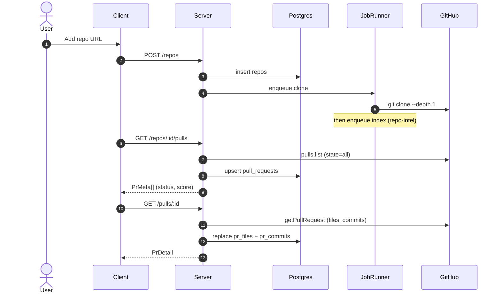
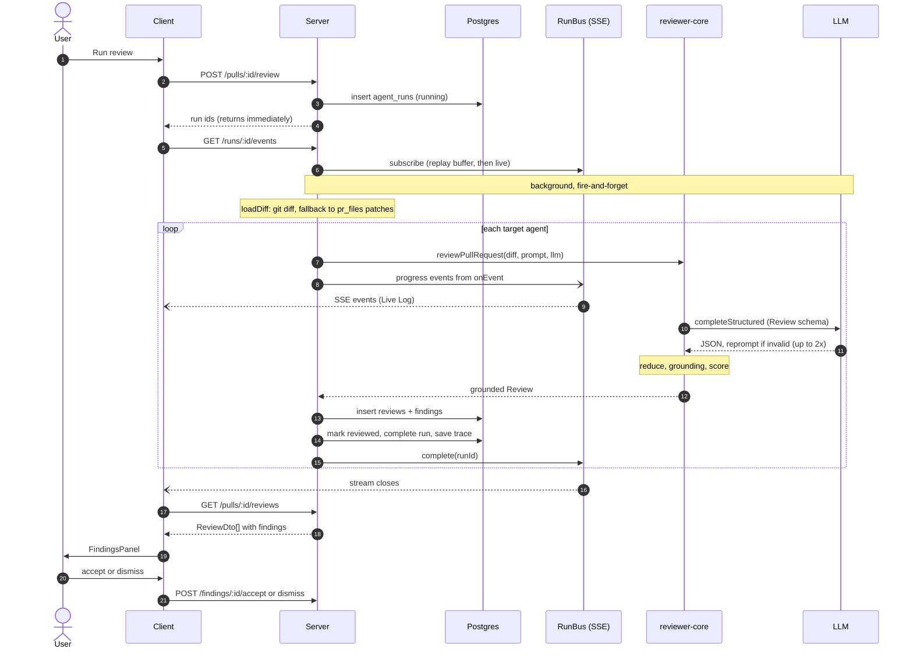
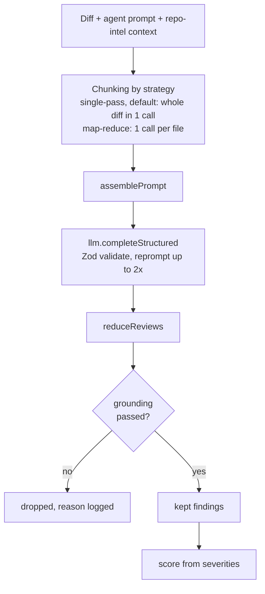
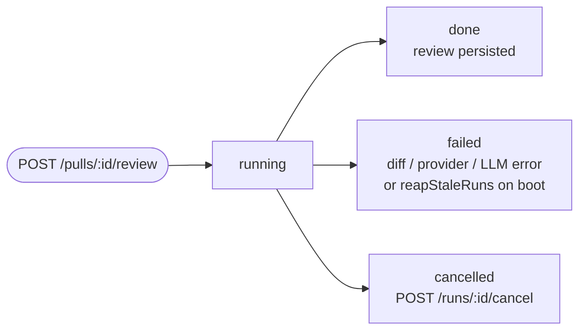

# Review workflow: from PR import to findings in the UI

> 🇺🇦 Ukrainian version: [review-workflow.uk.md](./review-workflow.uk.md)

End-to-end path of a pull request through DevDigest: adding the repo, syncing PRs,
running agents, the review engine, persistence, live streaming and the findings UI.

## Overview

### 1. Import: repo and PRs

### 2. Review run: from button to findings

## Review engine (reviewer-core)

## Run lifecycle (`agent_runs.status`)

---

## 1. Repo import

**`POST /repos`** → `server/src/modules/repos/service.ts` (`add`)

- `parseRepoUrl` extracts `owner/name`. An existing repo in the workspace is returned as-is (200).
- A `repos` row is inserted and a `clone` job is enqueued on `JobRunner`
  (`server/src/platform/jobs.ts`: p-queue, concurrency 3, 120s timeout, 2 retries;
  state mirrored in the `jobs` table).
- `runCloneJob` does a shallow clone (`CLONE_DEPTH = 1`). The URL is rebuilt from the
  validated `owner/name`, never taken from the payload. The token is never put in the URL.
- After the clone, an `index` job (repo-intel: repo map, file ranks, callers) is enqueued.
  It enriches the review prompt later.

## 2. PR import (list)

**`GET /repos/:id/pulls`** → `server/src/modules/pulls/routes.ts`

- With a GitHub token: `gh.listPullRequests` (Octokit, `state: 'all'`), then upsert into
  `pull_requests` on `(repo_id, number)`. On conflict it updates `title`, `headSha`,
  `status`, `updatedAt`.
- Without a token or offline it serves the persisted PRs. The read never fails (local-first).
- The list payload has no diff stats, so up to 10 PRs per request are backfilled from the detail endpoint.
- The list status comes from `deriveReviewStatus` (`server/src/modules/pulls/status.ts`):
  `needs_review` when `last_reviewed_sha ≠ head_sha`, `stale` after 7 days, otherwise `reviewed`.
- The score shown per PR is the score of its latest `review`.
- Manual sync: `POST /repos/:id/poll` (`server/src/modules/polling/routes.ts`). It does **not** trigger a review.

## 3. PR detail

**`GET /pulls/:id`** → `server/src/modules/pulls/routes.ts`

- `gh.getPullRequest` fully replaces `pr_files` (including each file's `patch`) and
  `pr_commits`, and updates `body` and the diff stats.
- `pr_files.patch` is the fallback diff source for the review.

## 4. Triggering a review

Client: `RunReviewDropdown` → `useRunReview` (`client/src/lib/hooks/reviews.ts`) →
**`POST /pulls/:id/review`** with `{agentId}` or `{all: true}`. Rate limit: 10/min.

`ReviewService.runReview` (`server/src/modules/reviews/service.ts`):

1. `resolveTargets` returns one agent or all enabled agents.
2. An `agent_runs` row (status `running`) is created **up front** for each agent, so the
   client gets a `runId` before any work starts.
3. `executor.executeRuns(...)` is launched with `void` (not awaited). The HTTP response
   with `runs` returns immediately.

## 5. Background execution

`ReviewRunExecutor` (`server/src/modules/reviews/run-executor.ts`)

**Shared pre-work (once for all agents):**

- `loadDiff` (`server/src/modules/reviews/diff-loader.ts`) first tries
  `git diff base...headSha` in the clone. If that throws or yields an empty diff, it
  rebuilds a unified diff from `pr_files.patch`.
- If the diff cannot be loaded, `failAll` marks every run `failed`, saves the trace and completes the bus.

**Per agent, sequentially (`runOneAgent`):**

1. `container.llm(provider)` returns the OpenAI or Anthropic adapter. A missing key fails the run.
2. If `agent.repoIntel !== false`, best-effort context is built: callers of changed
   symbols, repo skeleton, rank note ("N files are in the top 5% most-depended-on").
   Failures here only go to the log.
3. `taskLine(pull)` builds the task instruction. Key rule: never withhold a security/correctness finding.
4. The engine **`reviewPullRequest`** runs (section 6).
5. Persistence: `insertReview` (verdict, summary, score, model) → `insertFindings` →
   `markReviewed(pull.id, headSha)` → `completeAgentRun` (`done`, tokens, duration,
   grounding, `blockers = countBlockers(findings, agent.ciFailOn)`) → `saveRunTrace`
   (one JSON document: full prompt, raw output, log) → `runBus.complete(runId)`.
6. A failure or cancel of one agent persists `failed` / `cancelled` with the error text
   and the trace. The other agents keep running.

## 6. Engine: `@devdigest/reviewer-core`

`reviewer-core/src/review/run.ts`. Pure logic, no DB or GitHub; the CI runner uses the same code.

1. **Mode.** Default is `single-pass`: the whole diff in one LLM call
   (`server/src/modules/reviews/constants.ts`). `map-reduce` makes one call per file
   when configured on the agent.
2. **`assemblePrompt`** (`reviewer-core/src/prompt.ts`):
   - system = agent prompt + `INJECTION_GUARD`;
   - user = task, PR description (capped at 4000 chars), skills, memory, repo skeleton,
     specs, callers, diff.

   All external content is wrapped in `<untrusted source="…">`; attempts to close the tag are escaped.
3. **`llm.completeStructured<Review>`** with the Zod `Review` schema
   (`server/src/vendor/shared/contracts/findings.ts`):
   - OpenAI: `response_format: json_schema, strict`;
   - Anthropic: forced tool-use with `input_schema`.

   The output goes through `parseWithRepair`. Invalid JSON or schema mismatch triggers a
   reprompt listing the issues (up to 2 times).
4. **`reduceReviews`** (map-reduce): concatenates findings, takes the worst verdict.
5. **Citation grounding** (`reviewer-core/src/grounding.ts`): a finding is kept only if its
   `file` is in the diff and `[start_line, end_line]` intersects a new-side hunk line.
   The rest are dropped with a logged reason. Exception: kinds `secret_leak`,
   `lethal_trifecta`, `phantom`, `hook` only need the file to be in the diff.
6. **Score** is not the model's number. It is computed from the grounded findings:
   `100 − 35·CRITICAL − 12·WARNING − 3·SUGGESTION` (`reviewer-core/src/review/reduce.ts`).

Progress is emitted via `onEvent` → `RunLogger` → `RunBus`.

## 7. Live stream and UI

**SSE:** `GET /runs/:id/events` (`server/src/modules/reviews/routes.ts`). `RunBus`
(`server/src/platform/sse.ts`) keeps an in-memory buffer and an EventEmitter. A new
subscriber first gets the whole buffer, then live events. The stream ends on `done`.

**Client** (`client/src/app/repos/[repoId]/pulls/[number]/page.tsx`):

- `usePrActiveRuns` polls `/pulls/:id/runs/active` every 4s while anything is running.
  The state is server-sourced, so it survives a reload.
- `RunStatus` → `useRunEvents` opens an `EventSource` per `runId` and renders the Live Log.
  `error` events show a toast.
- When the stream closes, `onRunDone` invalidates `pr-active-runs` and `pr-runs` and calls
  `refetchReviews()` → `GET /pulls/:id/reviews`. Response: reviews newest-first, each with
  its findings (`reviewToDto`).
- `FindingsTab` → `ReviewRunAccordion` (one per run) → **`FindingsPanel`**: sorted
  CRITICAL → WARNING → SUGGESTION, "hide low confidence" toggle (threshold `< 0.65`),
  `j/k` navigation, `a`/`d` shortcuts.
- `FindingCard` → `POST /findings/:id/accept|dismiss` sets `accepted_at` or `dismissed_at`
  (mutually exclusive) → `reviews` query invalidated.
- `RunTraceDrawer` (`?trace=<runId>`) → `GET /runs/:id/trace`: full prompt, raw output, log.

---

## Known caveats

1. **`git diff` almost always fails and the fallback kicks in.** The clone is `depth=1`,
   and `fetchPullHead` (`server/src/adapters/git/simple-git.ts`) exists but is never called
   in production code. So the `headSha` commit and the merge-base for `base...head` are
   usually missing from the clone, and the diff is actually rebuilt from GitHub's
   `pr_files.patch`. GitHub truncates patches for large files and omits them for binary
   files, so those files are missing from the diff, and grounding drops findings on them
   ("file not present in diff").
2. **`pr_files` is only populated when the detail page is opened** (`GET /pulls/:id`).
   A review triggered right after a list sync, bypassing the UI, has nothing to rebuild the fallback diff from.
3. **`RunBus` state lives in memory only.** After a server restart `reapStaleRuns` cleans up
   hanging runs, but live events are gone. Completed run history is available from `run_traces`.
