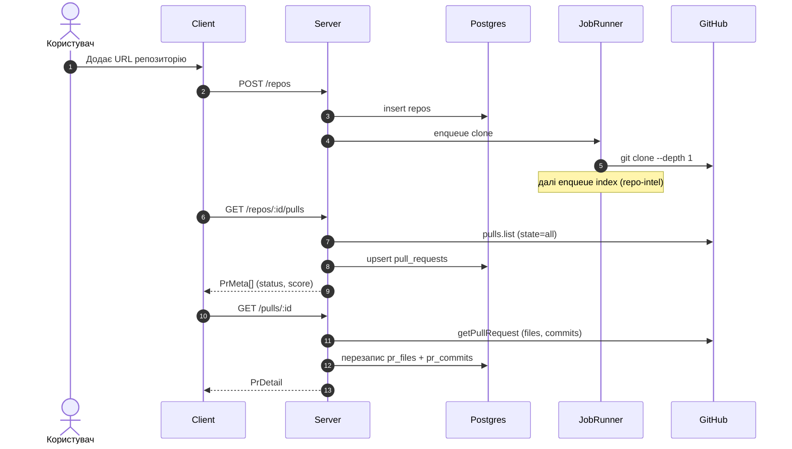
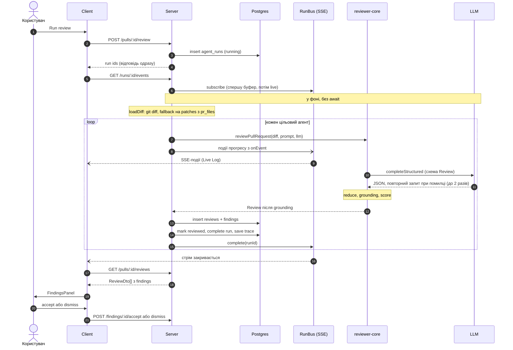
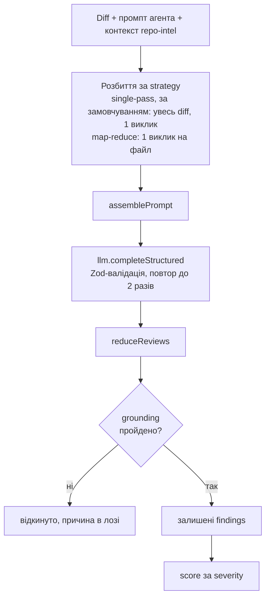
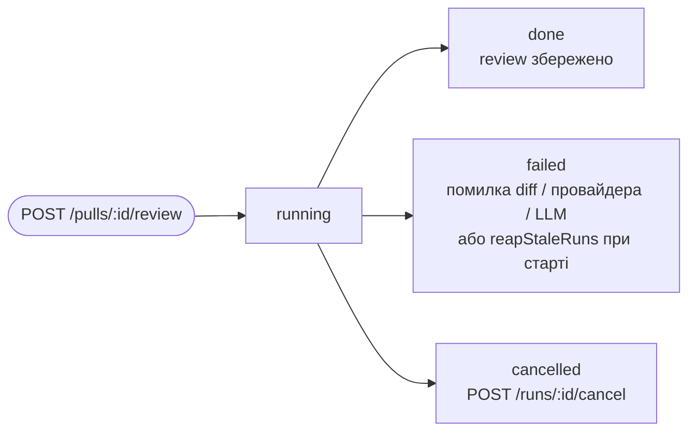

# Воркфлоу review: від імпорту PR до findings в UI

> 🇬🇧 English version: [review-workflow.md](./review-workflow.md)

Повний шлях pull request через DevDigest: додавання репозиторію, синхронізація PR,
запуск агентів, рушій review, запис у БД, live-стрім і показ findings в UI.

## Огляд

### 1. Імпорт: репозиторій і PR

### 2. Запуск review: від кнопки до findings

## Рушій review (reviewer-core)

## Життєвий цикл run (`agent_runs.status`)

---

## 1. Імпорт репозиторію

**`POST /repos`** → `server/src/modules/repos/service.ts` (`add`)

- `parseRepoUrl` виділяє `owner/name`. Якщо репо вже є у workspace, повертається наявний запис (200).
- Створюється рядок у `repos`, у `JobRunner` ставиться job `clone`
  (`server/src/platform/jobs.ts`: p-queue з concurrency 3, timeout 120s, 2 retry;
  стан job дублюється в таблицю `jobs`).
- `runCloneJob` робить shallow clone (`CLONE_DEPTH = 1`). URL збирається заново з
  провалідованих `owner/name`, а не береться з payload. Токен у URL не потрапляє.
- Після clone ставиться job `index` (repo-intel: repo map, ранги файлів, callers).
  Він потрібен пізніше для збагачення промпту.

## 2. Імпорт PR (список)

**`GET /repos/:id/pulls`** → `server/src/modules/pulls/routes.ts`

- Якщо є GitHub-токен, викликається `gh.listPullRequests` (Octokit, `state: 'all'`) і
  робиться upsert у `pull_requests` по `(repo_id, number)`. При конфлікті оновлюються
  `title`, `headSha`, `status`, `updatedAt`.
- Без токена або офлайн повертаються вже збережені PR. Читання не падає (local-first).
- Payload списку PR не містить diff-статистики, тому для 10 PR без неї за запит дотягується detail.
- Статус у списку обчислює `deriveReviewStatus` (`server/src/modules/pulls/status.ts`):
  `needs_review`, якщо `last_reviewed_sha ≠ head_sha`; `stale` після 7 днів; інакше `reviewed`.
- Score у списку береться з останнього `review` для кожного PR.
- Ручний sync є також через `POST /repos/:id/poll` (`server/src/modules/polling/routes.ts`).
  Review він **не** запускає.

## 3. Деталі PR

**`GET /pulls/:id`** → `server/src/modules/pulls/routes.ts`

- `gh.getPullRequest` повністю перезаписує `pr_files` (разом із `patch` кожного файлу) і
  `pr_commits`, а також оновлює `body` і статистику.
- `pr_files.patch` — це fallback-джерело diff для review.

## 4. Запуск review

Клієнт: `RunReviewDropdown` → `useRunReview` (`client/src/lib/hooks/reviews.ts`) →
**`POST /pulls/:id/review`** з `{agentId}` або `{all: true}`. Rate limit: 10 запитів на хвилину.

`ReviewService.runReview` (`server/src/modules/reviews/service.ts`):

1. `resolveTargets` повертає один агент або всі enabled.
2. Для кожного агента **одразу** створюється рядок `agent_runs` (status `running`), щоб
   клієнт мав `runId` ще до початку роботи.
3. `executor.executeRuns(...)` запускається через `void`, без await. HTTP-відповідь із
   `runs` повертається відразу.

## 5. Фонове виконання

`ReviewRunExecutor` (`server/src/modules/reviews/run-executor.ts`)

**Спільна підготовка (один раз на всіх агентів):**

- `loadDiff` (`server/src/modules/reviews/diff-loader.ts`) спершу пробує
  `git diff base...headSha` у клоні. Якщо команда падає або diff порожній, unified diff
  збирається з `pr_files.patch`.
- Якщо diff не завантажився, викликається `failAll`: усі runs отримують `failed`, trace
  зберігається, у bus іде `complete`.

**Для кожного агента послідовно (`runOneAgent`):**

1. `container.llm(provider)` повертає OpenAI- або Anthropic-адаптер. Якщо ключа немає, run завершується як failed.
2. Якщо в агента `repoIntel !== false`, збирається best-effort контекст: callers змінених
   символів, repo skeleton, rank note («N файлів у top-5% за кількістю залежностей»).
   Помилки тут лише пишуться в лог.
3. `taskLine(pull)` формує інструкцію задачі. Головне правило в ній: не приховувати security/correctness-проблеми.
4. Виклик рушія **`reviewPullRequest`** (розділ 6).
5. Запис результату: `insertReview` (verdict, summary, score, model) → `insertFindings` →
   `markReviewed(pull.id, headSha)` → `completeAgentRun` (`done`, токени, тривалість,
   grounding, `blockers = countBlockers(findings, agent.ciFailOn)`) → `saveRunTrace`
   (один JSON-документ з повним промптом, raw output і логом) → `runBus.complete(runId)`.
6. Помилка або cancel одного агента записує `failed`/`cancelled` з текстом помилки і
   trace. Інші агенти продовжують роботу.

## 6. Рушій: `@devdigest/reviewer-core`

`reviewer-core/src/review/run.ts`. Це чиста логіка без DB і GitHub; той самий код використовує CI runner.

1. **Вибір режиму.** За замовчуванням `single-pass`: увесь diff в одному LLM-виклику
   (`server/src/modules/reviews/constants.ts`). `map-reduce` робить окремий виклик на
   кожен файл, якщо так налаштовано агента.
2. **`assemblePrompt`** (`reviewer-core/src/prompt.ts`):
   - system = промпт агента + `INJECTION_GUARD`;
   - user = task, PR description (обрізаний до 4000 символів), skills, memory,
     repo skeleton, specs, callers, diff.

   Усе зовнішнє обгорнуте в `<untrusted source="…">`, а спроби закрити тег екрануються.
3. **`llm.completeStructured<Review>`** з Zod-схемою `Review`
   (`server/src/vendor/shared/contracts/findings.ts`):
   - OpenAI: `response_format: json_schema, strict`;
   - Anthropic: примусовий tool-use з `input_schema`.

   Відповідь проходить `parseWithRepair`. Якщо JSON або схема невалідні, моделі
   надсилається повторний запит із переліком помилок (до 2 разів).
4. **`reduceReviews`** (для map-reduce): findings об'єднуються, береться найгірший verdict.
5. **Citation grounding** (`reviewer-core/src/grounding.ts`): finding лишається, тільки
   якщо його `file` є в diff, а `[start_line, end_line]` перетинає new-side рядки
   якогось hunk. Решта відкидається з причиною, яка йде в лог. Виняток: kinds
   `secret_leak`, `lethal_trifecta`, `phantom`, `hook`; для них достатньо, щоб файл був у diff.
6. **Score** не береться з відповіді моделі, а детерміновано рахується з findings, що
   пройшли grounding: `100 − 35·CRITICAL − 12·WARNING − 3·SUGGESTION`
   (`reviewer-core/src/review/reduce.ts`).

Прогрес передається через `onEvent` у `RunLogger` → `RunBus`.

## 7. Live-стрім і показ в UI

**SSE:** `GET /runs/:id/events` (`server/src/modules/reviews/routes.ts`). `RunBus`
(`server/src/platform/sse.ts`) тримає in-memory буфер і EventEmitter. Новий підписник
спершу отримує весь буфер, потім live-події. На `done` стрім закривається.

**Клієнт** (`client/src/app/repos/[repoId]/pulls/[number]/page.tsx`):

- `usePrActiveRuns` запитує `/pulls/:id/runs/active` кожні 4s, поки є running. Дані
  беруться з сервера, тому стан переживає перезавантаження сторінки.
- `RunStatus` → `useRunEvents` відкриває `EventSource` на кожен `runId` і веде Live Log.
  Події `error` показуються toast-ом.
- Коли стрім закрився, `onRunDone` інвалідує `pr-active-runs` і `pr-runs` та викликає
  `refetchReviews()` → `GET /pulls/:id/reviews`. Відповідь: reviews від найновішого,
  кожен зі своїми findings (`reviewToDto`).
- `FindingsTab` → `ReviewRunAccordion` (по одному на run) → **`FindingsPanel`**:
  сортування CRITICAL → WARNING → SUGGESTION, перемикач «hide low confidence»
  (поріг `< 0.65`), навігація `j/k`, гарячі клавіші `a`/`d`.
- `FindingCard` → `POST /findings/:id/accept|dismiss` проставляє `accepted_at` або
  `dismissed_at` (взаємовиключно) → інвалідація `reviews`.
- `RunTraceDrawer` (`?trace=<runId>`) → `GET /runs/:id/trace`: повний промпт, raw output і лог.

---

## Відомі нюанси

1. **`git diff` майже завжди падає і спрацьовує fallback.** Clone має `depth=1`, а
   `fetchPullHead` (`server/src/adapters/git/simple-git.ts`) визначений, але в
   продакшн-коді ніде не викликається. Отже, коміту `headSha` і merge-base для
   `base...head` у клоні зазвичай немає, і diff фактично збирається з `pr_files.patch`
   GitHub. GitHub обрізає patch для великих файлів і не віддає його для бінарних, тому
   таких файлів у diff не буде. Grounding тоді відкине findings по них, бо файлу «немає в diff».
2. **`pr_files` заповнюється тільки при відкритті сторінки деталей** (`GET /pulls/:id`).
   Якщо запустити review в обхід UI одразу після sync списку, fallback не матиме з чого зібрати diff.
3. **Стан `RunBus` живе лише в пам'яті.** Після рестарту сервера `reapStaleRuns` прибирає
   завислі runs, але live-подій уже не буде. Після завершення run історію видно з `run_traces`.
